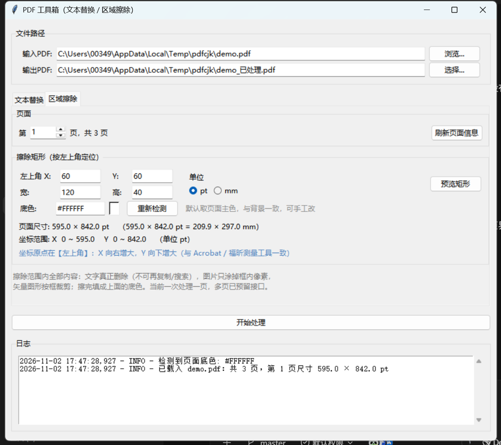

# PDF 工具箱 (PDFTextReplacer-plus)

[English](README.md) | [简体中文](README.zh-CN.md)

---

一个 Windows 桌面 PDF 处理小工具，基于 Python、Tkinter 和 PyMuPDF 构建。
源自 [ShawnJim/PDFTextReplacer](https://github.com/ShawnJim/PDFTextReplacer)（MIT），
在此基础上修复了中文显示问题、改用开源可商用字体，并新增了区域擦除功能。

## 📦 两个版本

两个版本由**同一份源码**构建，精简版只是不显示擦除页。两者体积几乎相同，
请按使用场景选择，不必看体积。

| 版本 | 文件 | 功能 |
|---|---|---|
| **完整版** | `PDF工具箱.exe` | 文本替换 **+** 区域擦除 |
| **精简版** | `PDF文本替换工具.exe` | 仅文本替换，单屏界面 |

两个都是单文件 exe，下载即用，不需要安装，也不需要旁边的任何文件夹。



## ✨ 功能特性

完整版有两个功能页，用标签切换，共用同一个输入/输出文件；精简版只有第一页。

### 一、文本替换

- **直观的图形界面**: 提供简单的图形化操作界面，无需使用命令行。
- **动态规则编辑**: 直接在应用内按 `原文|替换文` 的格式添加、编辑或粘贴替换规则。
- **多种替换策略**:
  - **`precise` (精确模式)**: 默认选项，能准确查找并替换文本，同时保留原始的字体、大小和颜色。
  - **`overlay` (覆盖模式)**: 在原文本上覆盖一个白色矩形再写入新文本，以确保最佳的兼容性。
  - **`hybrid` (混合模式)**: 为每次替换自动选择最优策略。
- **中文字体**: 只用开源可商用字体（Noto Sans SC / Noto Serif SC，SIL OFL 1.1），
  按原文字体风格自动挑宋体或黑体；也可把任意 `.ttf`/`.otf` 放进 `fonts` 文件夹覆盖。
- **实时日志**: 实时查看替换过程、计数以及任何潜在的问题。
- **结果验证**: 可选择在处理完成后，验证旧文本是否已全部被移除。

### 二、区域擦除（只擦不替换）

- 按**左上角坐标 + 宽高**指定一个矩形，把矩形内**所有内容**擦掉（不限文字）。
- 界面显示当前页的尺寸和坐标范围，页内坐标可直接读取；支持 `pt` / `mm` 两种单位。
- 擦除后填成页面底色（自动取页面主色，可手工改），看不出补丁。
- 擦除效果：文字真正删除（不可再复制/搜索）、图片只涂掉框内像素、矢量图形按框裁剪。
- **预览矩形**：先把框画在页面上看一眼，确认位置再执行。
- 一次处理一页；多页/多框的底层接口已预留。

> 坐标系说明：界面用**左上角原点**（X 向右、Y 向下），与 Acrobat / 福昕的测量工具一致。
> PDF 文件格式本身是左下角原点，这层转换由 PyMuPDF 内部完成，使用者不必关心。

### 通用

- **独立 `.exe` 文件**: 使用 PyInstaller 打包，可在没有 Python 环境的 Windows 上运行。

## 🚀 如何使用 (最终用户)

1.  从 [Releases](https://github.com/ShawnJim/PDFTextReplacer/releases) 页面下载并运行 `PDF Replacer.exe`。
2.  **选择输入PDF**: 点击“浏览...”选择您想要修改的PDF文件。
3.  **指定输出PDF**: 程序会自动生成一个输出路径。您也可以点击“选择...”自定义目标位置。
4.  按需要切换到对应标签页：
    - **文本替换**：输入替换规则，每行一条，格式 `原文|替换文`；选好替换方法后点“开始处理”。
    - **区域擦除**：填写页码、矩形左上角坐标与宽高（可切 pt/mm），
      必要时点“预览矩形”确认位置，再点“开始处理”。
5.  处理结束后会弹出确认消息，结果保存在您指定的输出位置。

## 🛠️ 如何构建 (开发者)

如果您想从源码运行或重新构建此应用，请按以下步骤操作。

### 1. 环境要求

- 已安装 Python 3.8+
- 已安装 Git

### 2. 克隆并设置环境

```bash
# 克隆仓库
git clone https://github.com/ShawnJim/PDFTextReplacer.git
cd PDFTextReplacer

# 创建并激活虚拟环境 (推荐)
python -m venv .venv
# Windows 系统
.venv\Scripts\activate
# macOS/Linux 系统
source .venv/bin/activate
```

### 3. 安装依赖

```bash
pip install -r requirements.txt
pip install pyinstaller
```

### 4. 从源码运行

```bash
python gui.py
```

### 5. 打包成 exe

一个脚本搞定两个版本：

```bash
python tools/build.py          # 两个版本都打
python tools/build.py --lite   # 只打精简版
python tools/build.py --full   # 只打完整版
```

脚本做了三件容易踩坑的事：

- 只把要分发的字体挑到 `build/fonts_pack`，不把 `fonts/_src` 里 40MB+ 的原始可变字体打进去；
- `--add-data` 用绝对路径（`--specpath` 会让相对路径相对 spec 目录解析）；
- 排除 PyMuPDF 附带的 layout/OCR 大依赖，体积从 66MB 降到 43MB。

产物直接输出到仓库根目录，打完自动清掉 `build/`。

### 6. 打包后自检

exe 是窗口程序没有控制台，自检结果会写到 `%TEMP%\pdfbox_selftest.log`：

```bash
"PDF工具箱.exe" --selftest
```

它会验证：字体是否随包解出、中文替换是否正常、区域擦除是否正常。退出码 0 表示通过。

## 📄 开源许可

本项目采用 MIT 许可，详见 [LICENSE](LICENSE)。

内置字体 Noto Sans SC / Noto Serif SC 采用 SIL Open Font License 1.1，
详见 [fonts/OFL.txt](fonts/OFL.txt)。

本项目基于 [ShawnJim/PDFTextReplacer](https://github.com/ShawnJim/PDFTextReplacer)。

## 命令行用法 (高级)

对于自动化或批处理任务，您可以直接从命令行使用核心脚本。这需要一个独立的规则文本文件。

**用法:**
```bash
python pdf_replacer_pymupdf.py <输入PDF> <输出PDF> <规则文件> [--method <方法>] [--verify]
```

**示例:**
```bash
# 使用默认的 'precise' 方法并验证结果
python pdf_replacer_pymupdf.py document.pdf document_updated.pdf rules.txt --verify
```

